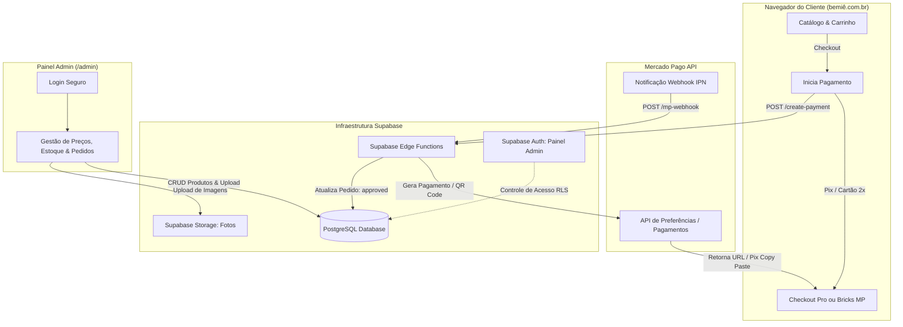

# 📋 Plano Arquitetural: Integração Mercado Pago, Supabase & Painel Admin (Bemiê Moda Praia)

> **Documento Estratégico & Técnico**  
> **Status:** Pronto para Análise Técnica & Validação Cruzada (Claude / Tech Lead)  
> **Autor:** Antigravity (Engenheiro Sênior & Braço Direito Técnico)  
> **Objetivo:** Estabelecer o roteiro completo de engenharia para transformar o e-commerce Bemiê de catálogo estático com fechamento via WhatsApp em um e-commerce transacional automatizado com **Mercado Pago**, banco de dados em tempo real no **Supabase** e **Painel Administrativo** para gestão de produtos, preços e estoque.

---

## 1. Parecer do Engenheiro Sênior: Por que precisamos de Banco de Dados?

Atualmente, o projeto Bemiê roda como uma SPA (Single Page Application) estática no Vite, lendo produtos de arquivos locais (`bemieProducts.json` e `siteData.ts`) e despachando pedidos para o WhatsApp. 

Para integrar o **Mercado Pago** de forma profissional e segura, **um banco de dados não é apenas recomendado — é estritamente obrigatório**. Os motivos técnicos são:

1. **Segurança de Credenciais:** As chaves de API secretas (`MP_ACCESS_TOKEN`, `WEBHOOK_SECRET`) jamais podem estar expostas no código do navegador (React/Vite). Qualquer chamada para criar preferências ou processar pagamentos precisa passar por um backend seguro.
2. **Idempotência e Prevenção de Furo de Estoque (*Overselling*):** Se houver apenas 1 unidade do "Biquíni Vermelho Cereja (G)" e duas clientes tentarem pagar simultaneamente, apenas um banco transacional com bloqueio atômico (*row-level locking* ou funções RPC) pode garantir que a peça não seja vendida duas vezes.
3. **Escuta de Webhooks do Mercado Pago:** O cliente pode fechar a janela do navegador após pagar no app do banco via Pix. A única forma confiável de saber que o dinheiro caiu é recebendo o webhook do Mercado Pago no backend e persistindo o status `approved` no banco.
4. **Independência de Deploy para Operações do Catálogo:** Hoje, para alterar um preço ou marcar uma peça como "esgotada", é necessário alterar código e fazer novo deploy. Com o **Supabase**, alterações de preço e cadastro de novas coleções ocorrem em tempo real pelo painel admin sem mexer no código.

---

## 2. Visão Geral da Arquitetura Proposta



---

## 3. Modelo de Dados Relacional (Schema PostgreSQL / Supabase)

Abaixo está a estrutura inicial de tabelas recomendada para o Supabase:

```sql
-- 1. TABELA DE CATEGORIAS
create table categories (
  id text primary key,
  name text not null,
  slug text not null unique,
  sort_order int default 0
);

-- 2. TABELA DE PRODUTOS
create table products (
  id text primary key,
  nome text not null,
  cor text,
  categoria_id text references categories(id),
  preco decimal(10,2) not null,
  preco_promocional decimal(10,2) default 0,
  desconto_percentual int default 0,
  oferta_tipo text default 'nenhuma', -- 'desconto' | 'nenhuma'
  style_tag text,
  estilos text[] default '{}',
  descricao text,
  ativo boolean default true,
  created_at timestamptz default now(),
  updated_at timestamptz default now()
);

-- 3. ESTOQUE POR TAMANHO (GRADE)
create table product_sizes (
  id uuid default gen_random_uuid() primary key,
  product_id text references products(id) on delete cascade,
  tamanho text not null, -- 'P', 'M', 'G', 'GG', 'U'
  quantidade int not null default 0 check (quantidade >= 0),
  unique(product_id, tamanho)
);

-- 4. FOTOS DO PRODUTO (VINCULADAS AO SUPABASE STORAGE)
create table product_photos (
  id uuid default gen_random_uuid() primary key,
  product_id text references products(id) on delete cascade,
  url text not null,
  sort_order int default 0
);

-- 5. TABELA DE PEDIDOS
create table orders (
  id uuid default gen_random_uuid() primary key,
  mp_payment_id text unique,
  mp_preference_id text,
  status text not null default 'pending', -- 'pending' | 'approved' | 'rejected' | 'cancelled'
  payment_method text, -- 'pix' | 'credit_card'
  installments int default 1,
  total decimal(10,2) not null,
  customer_name text not null,
  customer_email text not null,
  customer_phone text not null,
  customer_cpf text,
  shipping_address jsonb not null,
  created_at timestamptz default now(),
  updated_at timestamptz default now()
);

-- 6. ITENS DO PEDIDO
create table order_items (
  id uuid default gen_random_uuid() primary key,
  order_id uuid references orders(id) on delete cascade,
  product_id text references products(id),
  tamanho text not null,
  quantidade int not null check (quantidade > 0),
  preco_unitario decimal(10,2) not null
);
```

---

## 4. Roteiro de Tarefas e Subtarefas

### 📍 Fase 1: Arquitetura & Configuração do Supabase
- [ ] **1.1. Setup do Projeto no Supabase**
  - [ ] Criar organização e projeto Bemiê no Supabase (região `sa-east-1` / São Paulo para menor latência).
  - [ ] Configurar variáveis de ambiente de frontend (`VITE_SUPABASE_URL`, `VITE_SUPABASE_ANON_KEY`).
  - [ ] Criar bucket de storage público `product-images` com políticas de leitura pública e escrita autenticada.
- [ ] **1.2. Execução das Migrations do Banco**
  - [ ] Executar o script DDL com as tabelas `products`, `product_sizes`, `product_photos`, `orders`, `order_items`.
  - [ ] Configurar Row Level Security (RLS): Leitura pública de produtos ativos; gravação restrita apenas a usuários com role `admin`.
  - [ ] Criar função RPC PostgreSQL de decremento atômico de estoque com rollback automático se saldo < 0.
- [ ] **1.3. Migração Inicial de Dados**
  - [ ] Criar script de seed (`seed-bemie-data.ts`) para importar todo o conteúdo atual de `bemieProducts.json` diretamente para as novas tabelas do Supabase.
  - [ ] Validar integridade dos 18 produtos, fotos, cores e grades de estoque.

---

### 📍 Fase 2: Integração com Mercado Pago (Backend & Edge Functions)
- [ ] **2.1. Conta de Desenvolvedor & Credenciais**
  - [ ] Acessar o Portal de Desenvolvedores do Mercado Pago.
  - [ ] Obter credenciais de teste (Sandbox: `Public Key`, `Access Token`) e credenciais de produção.
  - [ ] Configurar segredos seguros no Supabase Vault (`MP_ACCESS_TOKEN`, `MP_WEBHOOK_SECRET`).
- [ ] **2.2. Supabase Edge Function: `create-preference`**
  - [ ] Criar endpoint HTTP serverless seguro que recebe itens do carrinho e dados da cliente.
  - [ ] Validar preços e disponibilidade de estoque diretamente no banco (nunca confiar nos valores enviados pelo cliente).
  - [ ] Suportar regra comercial da loja: Parcelamento em até 2x sem juros no cartão de crédito ou Pix à vista.
  - [ ] Retornar o `preference_id` e a URL de pagamento (`init_point`).
- [ ] **2.3. Supabase Edge Function: `mp-webhook`**
  - [ ] Criar rota para receber requisições de notificação do Mercado Pago (`topic=payment` ou `type=payment`).
  - [ ] Implementar verificação de assinatura criptográfica (`x-signature`) para evitar requisições forjadas.
  - [ ] Consultar API do Mercado Pago para conferir se o status real é `approved`.
  - [ ] Ao aprovar: atualizar `orders.status = 'approved'` e disparar baixa definitiva no estoque.
  - [ ] Registrar logs de auditoria e tratar idempotência (evitar processar a mesma notificação repetida).

---

### 📍 Fase 3: Experiência de Checkout no Frontend
- [ ] **3.1. Opções de Checkout**
  - [ ] *Decisão técnica:* **Checkout Pro** (redirecionamento oficial seguro com zero atrito PCI) vs. **Checkout Transparente** (Payment Bricks incorporado no modal do site).
  - [ ] Criar tela ou gaveta de confirmação com dados da cliente (Nome, WhatsApp, E-mail, CPF, Endereço de Entrega).
- [ ] **3.2. Integração do SDK do Mercado Pago**
  - [ ] Instalar `@mercadopago/sdk-react` (se Checkout Transparente) ou SDK oficial de redirecionamento.
  - [ ] Para Pix: Exibir QR Code gerado + botão "Copiar Código Pix" com contagem regressiva de expiração (30 min).
  - [ ] Para Cartão: Seleção de parcelas configurada com limite máximo de **2x sem juros**.
- [ ] **3.3. Página de Confirmação & Status do Pedido**
  - [ ] Criar rota `/pedido-confirmado?order_id=...` com acompanhamento em tempo real (via Supabase Realtime).
  - [ ] Exibir botão direto para o suporte no WhatsApp já com o número do pedido e resumo dos itens.

---

### 📍 Fase 4: Painel Administrativo de Produtos, Preços e Estoque
- [ ] **4.1. Autenticação e Acesso ao Painel**
  - [ ] Rota protegida: `/admin` (ou subdomínio dedicado `painel.bemiemodapraia.com.br`).
  - [ ] Login via Supabase Auth (E-mail e Senha forte com verificação de 2 fatores ou Magic Link).
  - [ ] Proteção de rota no React com verificação de sessão ativa e permissão `role = 'admin'`.
- [ ] **4.2. Módulo de Gestão Rápida de Catálogo**
  - [ ] Tabela com busca, filtros de categoria e ordenação.
  - [ ] Edição inline de preços (preço normal, preço promocional, ativação de desconto de 20%).
  - [ ] Atualização rápida de estoque por tamanho (P, M, G) com botão de 1 clique "Marcar como Esgotado".
- [ ] **4.3. Cadastro de Novos Produtos**
  - [ ] Formulário completo: Nome da peça, Cor, Categoria Lookbook (Asa Delta, Marquinha, Alça Dupla), Estilos/Tags.
  - [ ] Upload múltiplo de fotos com preview imediato e compressão automática para WebP.
  - [ ] Gravação no Supabase Storage e associação automática de URLs na tabela `product_photos`.
- [ ] **4.4. Módulo de Acompanhamento de Pedidos**
  - [ ] Listagem de pedidos recebidos com filtros: Pendentes, Pagos, Em separação, Enviados.
  - [ ] Visualização detalhada: itens, tamanho, dados de entrega e código de transação do Mercado Pago.
  - [ ] Botão de atalho para abrir conversa no WhatsApp com a cliente notificando o envio do código de rastreio.

---

### 📍 Fase 5: Notificações Automatizadas & WhatsApp Pós-Venda
- [ ] **5.1. Integração de Webhook com Disparo de Mensagens**
  - [ ] Configurar notificação por E-mail (via Resend ou SendGrid integrado ao Supabase) no momento da aprovação da compra.
  - [ ] (Opcional recomendado) Webhook para API de WhatsApp (Evolution API, Z-API ou Baileys) enviando confirmação automática de compra e código Pix na hora para a cliente.

---

### 📍 Fase 6: Homologação, Testes Automatizados & Go-Live
- [ ] **6.1. Bateria de Testes em Modo Sandbox**
  - [ ] Teste de ponta a ponta com cartões de teste do Mercado Pago (aprovação, recusa por saldo insuficiente, chargeback).
  - [ ] Teste de pagamento via Pix em ambiente de testes.
  - [ ] Teste de concorrência de estoque: duas tentativas simultâneas com 1 única peça disponível.
- [ ] **6.2. Testes de Falhas e Resiliência**
  - [ ] Teste de webhook atrasado ou reenviado múltiplas vezes.
  - [ ] Fallback caso a API do Mercado Pago fique instável (oferecer chave Pix manual ou WhatsApp direto como contingência).
- [ ] **6.3. Virada de Chave (Go-Live)**
  - [ ] Troca de credenciais Sandbox para chaves de Produção.
  - [ ] Realização de uma compra real de baixo valor (ex: R$ 5,00) para validação do fluxo financeiro completo até a conta do Mercado Pago.
  - [ ] Monitoramento ativo de logs de webhook nas primeiras 48 horas.

---

## 5. Instruções & Roteiro de Análise para o Claude (Prompt para Validação)

Copie e envie o bloco abaixo para o Claude para que ele avalie criticamente este plano:

```markdown
Olá, Claude! Atue como Engenheiro de Software Sênior e Arquiteto de Soluções E-commerce.
Por favor, analise o plano de implementação técnica acima para a loja Bemiê Moda Praia (React 19 + Vite + Supabase + Mercado Pago).

Gostaria que você validasse e refinasse este documento com os seguintes objetivos:
1. ARQUITETURA DE CHECKOUT: Avalie se para este nicho de moda praia (ticket médio ~R$ 130 a R$ 300) é mais vantajoso iniciar com Checkout Pro (redirecionamento oficial MP) ou Checkout Transparente (Bricks/Modal nativo), considerando taxa de conversão, complexidade de manutenção e antifraude.
2. CONCORRÊNCIA E ESTOQUE: Aponte potenciais falhas no fluxo de baixa de estoque e proponha a melhor abordagem no PostgreSQL/Supabase (ex: reservar estoque por X minutos durante a geração do Pix vs. dar baixa apenas no webhook approved).
3. SEGURANÇA E WEBHOOKS: Avalie se faltou alguma proteção contra fraudes, ataques de repetição ou vulnerabilidades no webhook do Mercado Pago.
4. ADMIN MVP: Proponha melhorias na modelagem do banco de dados e sugira a forma mais rápida e robusta de subir o painel de admin (ex: painel customizado no React vs. Supabase Studio / ferramentas low-code).
5. ENTREGÁVEL: Crie uma versão revisada e aprimorada deste plano com base nas suas observações, adicionando o código exemplo da Supabase Edge Function para o webhook do Mercado Pago com validação de assinatura.
```

---

## 6. Próximos Passos & Decisões Chave para o Usuário (Pedro)

Quando você estiver pronto e tiver o parecer do Claude, basta me avisar por aqui. As decisões imediatas que precisaremos definir são:

1. **Modalidade do Mercado Pago:** Preferência inicial por **Checkout Pro** (mais rápido, homologação imediata, menor risco de fraude) ou **Checkout Transparente** (cliente paga sem sair do domínio bemiê)?
2. **Localização do Painel Admin:** Rota interna do próprio site (`/admin`) protegida por senha, ou um subdomínio separado?
3. **Reserva de Estoque:** Deseja que a peça fique reservada assim que a cliente gera o Pix (por exemplo, por 30 minutos) ou apenas quando o pagamento for efetivamente aprovado?
